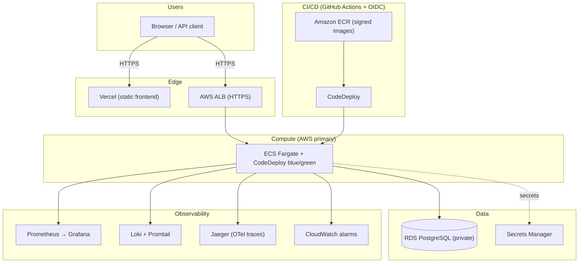

# Production-Ready DevSecOps Platform

[](https://github.com/yashbaviskar15/cicd-pipeline/actions/workflows/ci.yml)
[](https://github.com/yashbaviskar15/cicd-pipeline/actions/workflows/codeql.yml)
[](backend/jest.config.js)
[](docs/security.md)
[](LICENSE)
[](backend)
[](terraform)
[](deploy)

A portfolio-grade **Production-Ready DevSecOps Platform**: a real Task/Notes
REST API shipped through a secure, observable, multi-environment delivery
pipeline — the kind of thing an SRE/DevOps team actually runs.

> **The point of this repo is the pipeline and the platform, not the CRUD app.**
> The app exists so every claim (blue/green rollback, SLO alerts, autoscaling,
> IaC) can be demonstrated against something real.

---

## Why this exists (problem statement)

Standing up a container is easy; running a service **safely, cheaply and
observably** is not. This project answers the questions a production team faces:

- How do we ship changes **without downtime** and **roll back automatically**
  when a release is bad?
- How do we prove, on every PR, that code **is tested, scanned and signed**?
- How do we avoid **long-lived cloud credentials**?
- How do we know **whether users are affected** — and alert on that, not on CPU?
- How do we keep **three environments consistent** without copy-paste drift —
  and stay **free-tier friendly**?

Every answer is implemented, tested and documented here.

---

## 2-minute demo

<!-- Record with: asciinema/terminalizer, or a screen capture of `make up`, the
     CI PR checks, a blue/green deploy and the Grafana SLO dashboard. -->


*The demo shows: PR checks passing → merge → build/scan/sign → blue/green
deploy → post-deploy smoke test → Grafana SLO dashboard → an injected bad deploy
being rolled back automatically.*


---

## Architecture



There is also a **Kubernetes track** (Helm chart, Kustomize overlays, Argo CD
app-of-apps, optional EKS) so the same image can run either way.

Deeper design: [docs/architecture.md](docs/architecture.md) ·
Decisions: [docs/adr/](docs/adr/) · Deploys: [docs/deployment-guide.md](docs/deployment-guide.md).

---

## Tech stack

| Layer | Technology |
| --- | --- |
| **Application** | Node.js 20, Express 4, Prisma ORM |
| **Database** | PostgreSQL 16 (RDS `db.t4g.micro`, free-tier eligible) |
| **Auth** | JWT (access + refresh), bcrypt, `zod` validation, `express-rate-limit`, `helmet` |
| **Logging/observability** | `pino` JSON logs, `prom-client` metrics, OpenTelemetry tracing |
| **API docs** | OpenAPI 3.0.3 + Swagger UI at `/docs` |
| **Testing** | Jest + Supertest (>80% coverage gate), k6 load tests, e2e smoke tests |
| **Container** | Docker multi-stage, Alpine, non-root, healthcheck |
| **CI/CD** | GitHub Actions (reusable workflows, matrix), GitHub OIDC, semantic-release |
| **DevSecOps** | CodeQL, Trivy, Gitleaks, Hadolint, Checkov, tfsec, Syft SBOM, Cosign |
| **IaC** | Terraform (modules + 3 environments, S3/DynamoDB remote state) |
| **Cloud** | AWS VPC, ALB, ECS Fargate, ECR, RDS, Secrets Manager, CodeDeploy, CloudWatch |
| **Kubernetes** | Helm, Kustomize, Argo CD (GitOps), kind (local) |
| **Observability stack** | Prometheus, Grafana, Loki, Promtail, Alertmanager, OpenTelemetry, Jaeger |
| **DX** | Makefile, husky + lint-staged, devcontainer, EditorConfig |

---

## Highlights

- **Secure CI/CD** — SAST (CodeQL), dependency + image scanning (Trivy, fail on
  HIGH/CRITICAL), secret scanning (Gitleaks), IaC scanning (Checkov/tfsec),
  Dockerfile lint (Hadolint), **SBOM** (Syft) and **image signing** (Cosign).
- **No long-lived cloud credentials** — GitHub **OIDC** assumes a scoped IAM role.
- **Blue/green deploys with automatic rollback** — CodeDeploy + a post-deploy
  smoke test that reverts to the last known-good revision on failure.
- **Multi-environment IaC** — reusable Terraform modules, per-env tfvars,
  independent remote state with DynamoDB locking, PR plan comments, Infracost
  estimates and a manual approval gate for prod.
- **SLO-driven reliability** — 99.5% availability / p95 < 300 ms, multi-window
  burn-rate alerts, three runbooks and documented failure drills.
- **Observability as code** — Prometheus rules, Grafana dashboards and
  datasources are version-controlled.
- **Performance in CI** — k6 smoke test on every PR, stress test on demand.
- **Kubernetes ready** — Helm chart + Kustomize overlays + Argo CD app-of-apps.

---

## Quickstart

```bash
git clone https://github.com/yashbaviskar15/cicd-pipeline.git
cd cicd-pipeline

make setup      # install deps + git hooks
make up         # start postgres + backend + frontend
make obs-up     # start Prometheus + Grafana + Loki + Jaeger (optional)
```

| Service | URL |
| --- | --- |
| Frontend dashboard | http://localhost:8080 |
| API | http://localhost:3000 |
| API docs (Swagger) | http://localhost:3000/docs |
| Metrics | http://localhost:3000/metrics |
| Grafana | http://localhost:3001 (admin/admin) |
| Prometheus | http://localhost:9090 |
| Jaeger | http://localhost:16686 |

`make help` lists every target (`lint`, `test`, `scan`, `tf-plan`, `load-test`,
`k8s-up`, …). Run `make doctor` to check your tooling.

### API at a glance

| Method | Path | Description |
| --- | --- | --- |
| `POST` | `/api/auth/register` | Register a user |
| `POST` | `/api/auth/login` | Log in, returns access + refresh tokens |
| `POST` | `/api/auth/refresh` | Exchange a refresh token |
| `GET` | `/api/auth/me` | Current user |
| `GET`/`POST` | `/api/tasks` | List / create tasks (paginated, filterable) |
| `GET`/`PATCH`/`PUT`/`DELETE` | `/api/tasks/{id}` | Read / update / delete a task |
| `GET` | `/api/tasks/stats` | Task counts by status |
| `GET` | `/health`, `/health/live`, `/health/ready` | Health / liveness / readiness |
| `GET` | `/metrics`, `/docs` | Prometheus metrics, Swagger UI |

Full, always-current reference: **http://localhost:3000/docs**.

---

## Design decisions

The interesting part of a platform is the *why*. Recorded as ADRs:

| Decision | ADR |
| --- | --- |
| ECS Fargate over EKS | [0001](docs/adr/0001-ecs-fargate-over-eks.md) |
| Blue/green over rolling updates | [0002](docs/adr/0002-blue-green-over-rolling-deploys.md) |
| Reusable Terraform modules + multi-env | [0003](docs/adr/0003-terraform-modules-and-multi-env.md) |
| GitHub OIDC over static AWS keys | [0004](docs/adr/0004-github-oidc-over-static-keys.md) |
| PostgreSQL + Prisma | [0005](docs/adr/0005-postgresql-prisma.md) |
| Observability stack + SLO alerting | [0006](docs/adr/0006-observability-and-slos.md) |

---

## Security model

Defence in depth, enforced in CI (see [docs/security.md](docs/security.md)):

- **Identity:** OIDC-assumed, short-lived AWS credentials — no static keys.
- **Supply chain:** SBOM, image signing (Cosign keyless) + verification.
- **Code & CI:** CodeQL, Gitleaks, Trivy, Hadolint, Checkov/tfsec — all required
  checks that block merges.
- **Runtime:** least-privilege IAM, private subnets for tasks/DB, TLS everywhere,
  `zod` input validation, rate limiting, `helmet`, non-root read-only containers.
- **Secrets:** Secrets Manager (AWS) / GitHub vars (CI) / `.env` (local) —
  never committed; `.env.example` is the template.

---

## Cost breakdown

The platform is designed to run **near free-tier**. Below is the realistic
monthly cost for a **small always-on prod** environment (us-east-1, on-demand,
no free tier assumed). Dev/staging are much cheaper (single NAT, 1 task).

| Resource | Config | ~Monthly |
| --- | --- | --- |
| ECS Fargate | 0.25 vCPU / 0.5 GB, 2 tasks, always on | ~$18 |
| Application Load Balancer | 1 ALB + minimal LCU | ~$18 |
| NAT Gateway | 1 NAT + light data processing | ~$33 |
| RDS PostgreSQL | `db.t4g.micro`, 20 GB gp3, single-AZ | ~$13 |
| ECR | 2 repos, a few GB, lifecycle-pruned | ~$1 |
| Secrets Manager | 1–2 secrets | ~$1 |
| CloudWatch | logs + alarms + dashboard | ~$5 |
| Route 53 + ACM | optional hosted zone, ACM cert free | ~$1 |
| **Total** | | **≈ $90 / month** |

Ways it drops dramatically:

- **Free tier / t4g.micro RDS** can make the DB ~$0 for 12 months.
- **Fargate Spot** (`use_fargate_spot = true`) cuts compute ~70%.
- **Destroy non-prod** when idle (`terraform destroy`), keep only dev.
- **Single NAT gateway** in dev (`single_nat_gateway = true`) already applied.
- Running everything **locally** (docker compose + observability) costs $0.

> Always run `terraform destroy` on throwaway environments. The ALB and NAT
> gateway are the two line items that quietly bill 24/7.

---

## Project structure

```text
cicd-pipeline/
├── backend/                 # Node/Express API (Prisma, JWT, metrics, OpenAPI)
├── frontend/                # Nginx static dashboard (auth, CRUD, live metrics)
├── .github/workflows/       # CI: reusable workflows, CodeQL, security, deploy
├── terraform/
│   ├── bootstrap/           # S3 state bucket + DynamoDB lock table
│   ├── modules/             # vpc, alb, ecs, rds, ecr, iam, monitoring, (eks)
│   ├── environments/        # dev, staging, prod (tfvars + remote state)
│   └── legacy/              # original flat config (reference only)
├── deploy/
│   ├── helm/backend/        # Helm chart (probes, HPA, PDB, ServiceMonitor)
│   ├── k8s/                 # Kustomize base + dev/prod overlays
│   ├── argocd/              # GitOps app-of-apps
│   └── kind/                # local cluster config
├── observability/           # Prometheus, Grafana, Loki, Promtail, OTel configs
├── tests/load/              # k6 smoke + stress scripts
├── scripts/                 # smoke-test.mjs, windows/ (legacy scripts)
├── docs/                    # architecture, security, ADRs, runbooks, SLOs …
├── docker-compose.yml       # app stack
├── docker-compose.observability.yml
└── Makefile                 # make help
```

---

## Documentation

| Doc | Contents |
| --- | --- |
| [architecture.md](docs/architecture.md) | System, request lifecycle and pipeline diagrams |
| [deployment-guide.md](docs/deployment-guide.md) | Bootstrap → deploy → promote → rollback → teardown |
| [security.md](docs/security.md) | Threat model, controls, how to verify |
| [troubleshooting.md](docs/troubleshooting.md) | Symptom → cause → fix |
| [slo.md](docs/slo.md) | SLIs, SLOs, error budget, burn-rate alerts |
| [runbooks/](docs/runbooks/) | service-down, high-error-rate, high-latency |
| [chaos-drill.md](docs/chaos-drill.md) | Kill a task, break the DB, bad deploy |
| [branch-protection.md](docs/branch-protection.md) | Required checks, branch rules |
| [adr/](docs/adr/) | Architecture Decision Records |
| [interview-talking-points.md](docs/interview-talking-points.md) | STAR answers for this project |

---

## What I learned

- **Automation is a system, not a script.** Splitting PR checks from the main
  pipeline (reusable workflows) kept feedback fast and deploys safe.
- **Security gates must block merges to matter.** A scan that warns and passes
  is decoration; required checks turn policy into truth.
- **Credibility comes from trade-offs.** Choosing Fargate over EKS because the
  team is small was more defensible than chasing Kubernetes — and shipping the
  Kubernetes track *as an option* proved I could do both.
- **Alert on symptoms, not causes.** Burn-rate alerts on an SLO page you when
  users hurt; CPU alerts mostly page you for nothing.
- **Rollback is a feature you must rehearse.** The chaos drills turned "we could
  roll back" into "we have rolled back, here's the evidence".
- **Free-tier discipline is design.** Single NAT, Spot, lifecycle policies and
  `terraform destroy` are architecture decisions, not afterthoughts.

---

## License

MIT — see [LICENSE](LICENSE).

## Author

**Yash Baviskar** · [GitHub @yashbaviskar15](https://github.com/yashbaviskar15) ·
[LinkedIn](https://www.linkedin.com/in/yashbaviskar15)
