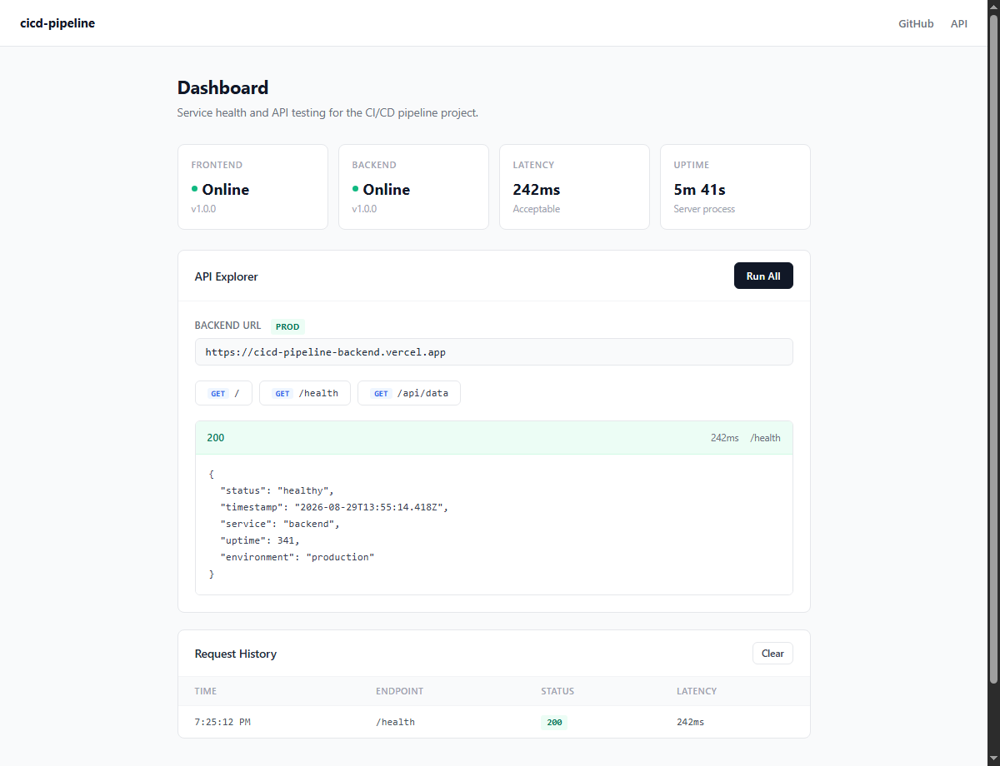
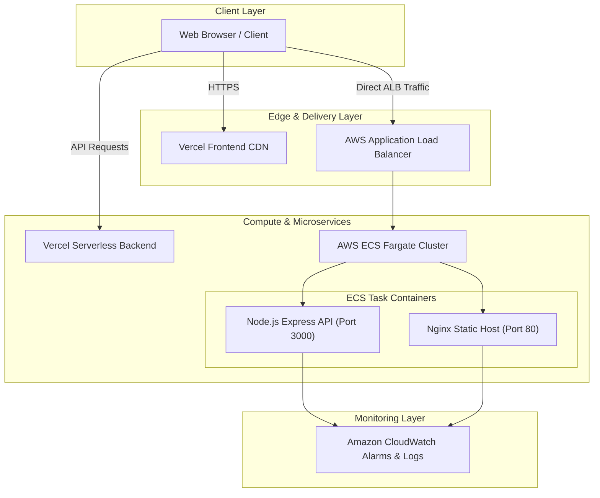
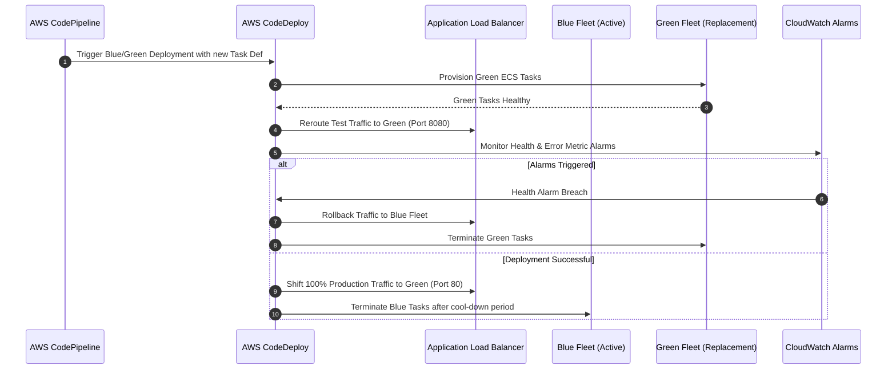

# CI/CD Pipeline and Cloud Infrastructure

[](https://github.com/yashbaviskar15/cicd-pipeline/actions/workflows/ci.yml)
[](LICENSE)
[](backend)
[](docker-compose.yml)
[](docs/aws-setup.md)
[](terraform)

A production-style CI/CD pipeline and cloud infrastructure demonstration. This project showcases modern DevOps engineering practices including containerization, automated testing, linting, continuous integration, blue/green deployments, infrastructure as code, and observability.

---

## Live Deployments

- Frontend Dashboard: [cicd-pipeline-frontend.vercel.app](https://cicd-pipeline-frontend.vercel.app/)
- Backend Service: [cicd-pipeline-backend.vercel.app](https://cicd-pipeline-backend.vercel.app/)
- Repository: [github.com/yashbaviskar15/cicd-pipeline](https://github.com/yashbaviskar15/cicd-pipeline)



---

## Table of Contents

- [System Architecture](#system-architecture)
- [CI/CD Pipeline Flow](#cicd-pipeline-flow)
- [Blue/Green Deployment Flow](#bluegreen-deployment-flow)
- [Tech Stack](#tech-stack)
- [API Reference](#api-reference)
- [Local Development](#local-development)
- [Testing and Linting](#testing-and-linting)
- [Infrastructure as Code](#infrastructure-as-code)
- [Project Structure](#project-structure)
- [Cost and Resource Estimation](#cost-and-resource-estimation)
- [License](#license)
- [Author](#author)

---

## System Architecture

The project consists of a decoupled frontend dashboard and backend REST API service designed for multi-environment deployment (local Docker containers, Vercel Serverless, and AWS ECS Fargate behind an Application Load Balancer).



---

## CI/CD Pipeline Flow

Every code commit triggers an automated pipeline that validates code quality, executes unit tests, constructs multi-stage Docker images, and deploys artifacts.

```mermaid
flowchart LR
    subgraph Source["Source Control"]
        Dev["Developer"] -->|git push| GitHub["GitHub Repo (main branch)"]
    end

    subgraph CI["GitHub Actions CI Pipeline"]
        GitHub --> ActionLint["Setup Node.js & npm ci"]
        ActionLint --> LintStep["Lint Check (ESLint)"]
        LintStep --> TestStep["Unit Tests (Jest & Supertest)"]
        TestStep --> DockerBuild["Docker Build (Backend & Frontend)"]
        DockerBuild --> SmokeTest["Container Smoke Tests (curl health)"]
    end

    subgraph Deploy["Automated Deployment"]
        SmokeTest --> VercelDeploy["Vercel Production Deploy"]
        SmokeTest --> AWSDeploy["Push Images to Amazon ECR"]
        AWSDeploy --> CodePipeline["AWS CodePipeline / CodeDeploy"]
    end

    subgraph Target["Live Environments"]
        VercelDeploy --> LiveVercel["Production Web Dashboard"]
        CodePipeline --> LiveECS["AWS ECS Fargate (Zero Downtime)"]
    end
```



---

## Blue/Green Deployment Flow

For AWS deployments, CodeDeploy orchestrates zero-downtime blue/green traffic shifting with automatic rollback on CloudWatch error spikes.



---

## Tech Stack

| Layer | Technology | Details |
|---|---|---|
| Backend | Node.js, Express 4.x | REST API, CORS support, JSON serialization |
| Frontend | HTML5, CSS3, JavaScript ES6+ | Responsive light dashboard, live metrics, API explorer |
| Containerization | Docker, Docker Compose | Multi-stage production builds, Alpine Linux base |
| Continuous Integration | GitHub Actions | Automated linting, Jest testing, Docker smoke tests |
| Container Registry | Amazon ECR | Versioned Docker image repository |
| Cloud Compute | AWS ECS (Fargate) | Serverless container orchestration |
| Load Balancing | AWS ALB | HTTP/HTTPS routing, target groups, health probes |
| Deployment Automation | AWS CodeDeploy, Vercel | Blue/green zero-downtime deployment, serverless edge |
| Infrastructure as Code | HashiCorp Terraform | Modular infrastructure definitions with state control |
| Monitoring & Logs | Amazon CloudWatch | Metric alarms, container logs, auto-rollback hooks |
| Testing Suite | Jest, Supertest, ESLint | Unit testing, HTTP assertion, static code analysis |

---

## API Reference

The backend exposes the following REST endpoints:

| Method | Endpoint | Description | Sample Response |
|---|---|---|---|
| `GET` | `/` | Service overview, status, and endpoint directory | `{"service":"cicd-backend","status":"healthy","version":"1.0.0","uptime":120,"endpoints":[...]}` |
| `GET` | `/health` | Health probe for load balancers and orchestrators | `{"status":"healthy","timestamp":"2026-08-29T...","service":"backend","uptime":120,"environment":"production"}` |
| `GET` | `/api/data` | Sample payload endpoint for frontend consumers | `{"message":"Hello from the backend service!","version":"1.0.0","timestamp":"2026-08-29T..."}` |

---

## Local Development

### Prerequisites
- Node.js 20+ and npm
- Docker Desktop
- Git

### Option 1: Run with Docker Compose
```bash
# Clone the repository
git clone https://github.com/yashbaviskar15/cicd-pipeline.git
cd cicd-pipeline

# Build and start all services
docker compose up -d --build

# View container logs
docker compose logs -f

# Stop services
docker compose down
```

Local service ports:
- Frontend Dashboard: `http://localhost:8080`
- Backend API: `http://localhost:3000`

### Option 2: Run Backend Directly with Node.js
```bash
cd backend
npm install
npm run dev     # Starts with nodemon on port 3000
```

### Option 3: Using Windows Batch Scripts
- Double-click `build.bat` to build images.
- Double-click `start.bat` to run the stack.
- Double-click `stop.bat` to stop containers.

---

## Testing and Linting

All unit tests and lint checks can be run locally using the npm scripts:

```bash
cd backend

# Run ESLint static analysis
npm run lint

# Run Jest unit and integration tests
npm test
```

---

## Infrastructure as Code

AWS cloud resources are fully defined using Terraform inside the `terraform/` directory:

| File | Resource Provisioned |
|---|---|
| `vpc.tf` | Custom VPC with public/private subnets and route tables |
| `alb.tf` | Application Load Balancer, listeners, and target groups |
| `ecs.tf` | ECS Cluster, Task Definitions, and Fargate Services |
| `ecr.tf` | Amazon Elastic Container Registries for frontend & backend |
| `codepipeline.tf` | CodePipeline stages (Source, Build, Deploy) |
| `codedeploy.tf` | CodeDeploy Blue/Green deployment configuration |
| `cloudwatch.tf` | CloudWatch log groups and rollback metric alarms |
| `iam.tf` | Least-privilege IAM roles and execution policies |

To plan or apply infrastructure changes:
```bash
cd terraform
terraform init
terraform plan
terraform apply
```

---

## Project Structure

```text
cicd-pipeline/
├── .github/
│   └── workflows/
│       ├── ci.yml                 # GitHub Actions CI workflow
│       └── deploy.yml             # AWS ECR container build & push workflow
├── backend/
│   ├── src/
│   │   ├── index.js               # Express application entry point
│   │   └── index.test.js          # Jest and Supertest test suite
│   ├── .dockerignore
│   ├── .eslintrc.json             # ESLint configuration
│   ├── Dockerfile                 # Multi-stage Docker build
│   ├── package.json
│   ├── package-lock.json
│   └── vercel.json                # Vercel serverless routing
├── frontend/
│   ├── Dockerfile                 # Nginx-based container build
│   ├── index.html                 # Production dashboard UI
│   └── vercel.json                # Vercel static routing
├── terraform/                     # Complete Terraform IaC modules
├── buildspec.yml                  # AWS CodeBuild specification
├── docker-compose.yml             # Local multi-container configuration
├── .gitignore
├── LICENSE                        # MIT License
└── README.md
```

---

## Cost and Resource Estimation

Estimated AWS baseline costs for running this infrastructure:

| Resource | Estimated Cost | Free Tier Available |
|---|---|---|
| Amazon ECS Fargate | ~$0.01 per task-hour (0.25 vCPU / 0.5 GB RAM) | Yes |
| Application Load Balancer | ~$0.025 per hour + LCU usage | No |
| Amazon ECR | $0.10 per GB-month (first 500 MB free) | Yes |
| Amazon CloudWatch | Metrics and logs within standard free allocation | Yes |

To prevent ongoing cloud charges when finished testing:
```bash
cd terraform
terraform destroy
```

---

## License

This project is open source and available under the [MIT License](LICENSE).

---

## Author

**Yash Baviskar**
- GitHub: [@yashbaviskar15](https://github.com/yashbaviskar15)
- LinkedIn: [Yash Baviskar](https://www.linkedin.com/in/yashbaviskar15)
