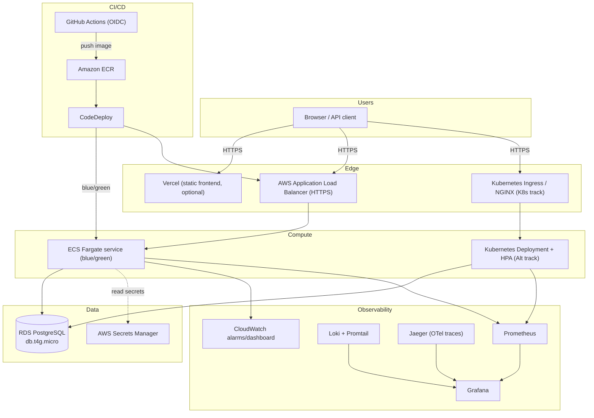
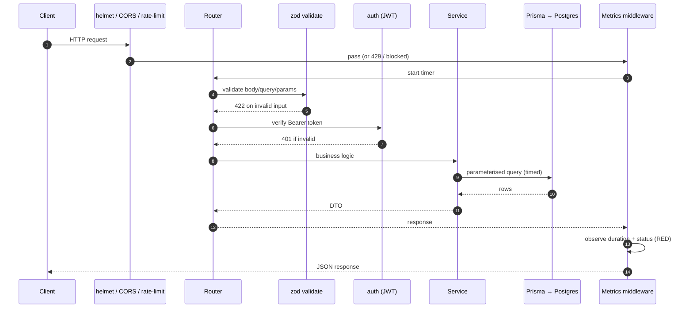
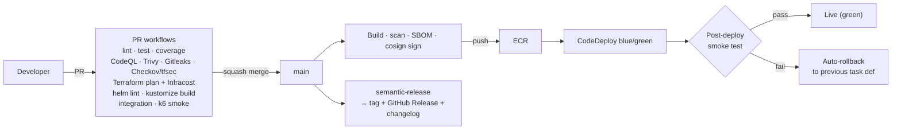
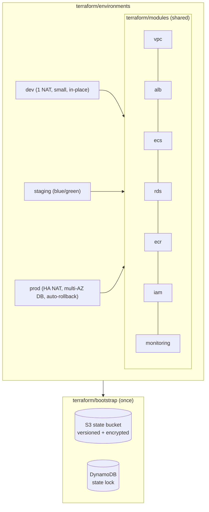

# Architecture

> High-level design of the **Production-Ready DevSecOps Platform**. For the
> rationale behind individual choices see the [ADRs](./adr/), and for an
> end-to-end operator walkthrough see the
> [deployment guide](./deployment-guide.md).

## 1. System context

There are **two deployment tracks** that share the same application artifact:

1. **AWS track (primary):** ECS Fargate behind an ALB with CodeDeploy blue/green
   and CloudWatch-driven rollback. Provisioned by the multi-environment
   Terraform in [`terraform/`](../terraform).
2. **Kubernetes track (alternative):** the same image deployed via a Helm chart
   / Kustomize overlays, synced by Argo CD (app-of-apps). Lives in
   [`deploy/`](../deploy). Useful for teams already on Kubernetes; the Terraform
   for EKS is optional and carries a cost warning.

## 2. Application

A single Node.js 20 / Express service:

| Concern | Implementation |
| --- | --- |
| API | Express router, `zod` request validation, central error handler |
| Auth | JWT access + refresh tokens, bcrypt password hashing |
| Data | Prisma ORM over PostgreSQL |
| Hardening | `helmet`, CORS allow-list, `express-rate-limit` (global + stricter on auth) |
| Config | `zod`-validated environment schema — fail fast at boot |
| Logging | `pino` structured JSON with a per-request correlation id |
| Metrics | `prom-client`: RED metrics, DB latency histogram, business counters |
| Tracing | OpenTelemetry (opt-in) HTTP + Express instrumentation |
| Docs | OpenAPI 3.0.3 served with Swagger UI at `/docs` |
| Lifecycle | `/health/live` (liveness), `/health/ready` (DB readiness), graceful shutdown on `SIGTERM` |

### Request lifecycle

## 3. CI/CD pipeline

**Security gates** (all fail the build on violation): CodeQL SAST, `npm audit`,
Trivy image scan (HIGH/CRITICAL), Gitleaks secret scan, Hadolint Dockerfile
lint, Checkov + tfsec IaC scan, Syft SBOM, Cosign keyless signature.

**Supply chain:** images are signed with Cosign (keyless, tied to the GitHub
OIDC identity) and verified, and an SBOM is produced for every build.

## 4. Multi-environment infrastructure

Each environment is an independent root module with its **own state** in S3
(locked via DynamoDB) and its own `terraform.tfvars`. Differences between
environments are parameters, not topology.

## 5. Reliability model

- **Health:** liveness vs readiness separated — a dependency outage drains
  traffic instead of causing a restart loop.
- **Autoscaling:** ECS Application Auto Scaling on CPU and ALB
  request-count-per-target; Kubernetes HPA on CPU/memory.
- **Deploys:** blue/green with automatic rollback on failure/alarm + post-deploy
  smoke test rollback.
- **SLOs:** 99.5% availability, p95 < 300 ms, enforced by burn-rate alerts
  ([slo.md](./slo.md)).
- **Runbooks:** [service-down](./runbooks/service-down.md),
  [high-error-rate](./runbooks/high-error-rate.md),
  [high-latency](./runbooks/high-latency.md).
- **Drills:** documented, repeatable failure injections in
  [chaos-drill.md](./chaos-drill.md).
