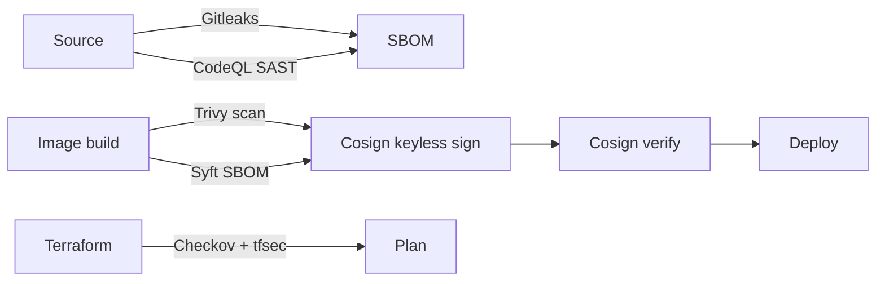

# Security Model

This platform is built **secure by default** and **secure by CI**: controls are
enforced in code and in the pipeline, not left to convention. This document
describes the threat model, the controls in place, and how to verify them.

## Threat model (what we defend against)

| Threat | Control |
| --- | --- |
| Credential/secret leakage in the repo or logs | Gitleaks scanning (CI + pre-commit), no secrets in code, `.env.example` only |
| Compromised CI credentials | GitHub OIDC → short-lived IAM role, no long-lived AWS keys ([ADR 0004](./adr/0004-github-oidc-over-static-keys.md)) |
| Vulnerable dependencies | Dependabot, `npm audit`, Trivy filesystem/image scan (fail on HIGH/CRITICAL) |
| Vulnerable base image / Dockerfile mistakes | Minimal `alpine` base, multi-stage build, non-root user, Hadolint |
| Misconfigured cloud infrastructure | Checkov + tfsec on every Terraform PR; least-privilege IAM; private subnets |
| Injection / malformed input | `zod` validation on all bodies/params/queries; Prisma parameterised queries |
| Brute force / abuse | `express-rate-limit` globally and stricter on auth routes |
| XSS / clickjacking / MIME sniffing | `helmet` security headers |
| Tampered container images | Cosign keyless signing + verification; Syft SBOM |
| Data at rest / in transit | RDS storage encryption, Secrets Manager KMS, HTTPS-only ALB, TLS ingress |

## Application controls

- **Authentication:** JWT access token (short-lived, `15m`) + refresh token
  (`7d`). Passwords hashed with bcrypt (configurable cost; `10` in prod).
- **Authorisation:** every task operation is scoped to the authenticated user;
  cross-user access returns `404` rather than `403` to avoid leaking existence.
- **Input validation:** `zod` schemas validate the body, query and params.
  Invalid input → `422` with a structured error, never a 500.
- **Rate limiting:** a global limiter plus a stricter limiter on
  `/api/auth/*` ([`rateLimiter.js`](../backend/src/middleware/rateLimiter.js)).
- **Headers:** `helmet` with CSP relaxed **only** for Swagger UI, cross-origin
  embedder policy disabled for docs — both documented in
  [`app.js`](../backend/src/app.js).
- **Errors:** a central error handler never leaks stack traces or internals in
  production; unexpected errors become a generic `500` logged with a
  correlation id.
- **Config:** the environment schema is validated with `zod` at boot; the app
  refuses to start in production with a default/weak `JWT_SECRET`.
- **Logging:** `pino` structured JSON. Secrets/passwords are never logged;
  request bodies are not logged by default.

## Secrets management

| Environment | Mechanism |
| --- | --- |
| Local | `.env` (git-ignored) copied from `.env.example` |
| CI | GitHub repository **variables** for non-sensitive config; OIDC for AWS |
| AWS prod | **AWS Secrets Manager** — DB credentials and `JWT_SECRET` are generated by Terraform (`random_password`) and injected into the task definition via `valueFrom` |

No secret is ever committed. `terraform.tfvars`, `.env*` and state files are
git-ignored. Use [`backend/.env.example`](../backend/.env.example) as the
template.

## Infrastructure controls (AWS)

- **Network:** VPC with public subnets (ALB only) and **private** subnets for
  app tasks and RDS. RDS is not publicly accessible.
- **Security groups:** minimal, referential rules — ALB SG → app SG on `3000`,
  app SG → DB SG on `5432`. No `0.0.0.0/0` on data ports.
- **IAM:** least privilege. The GitHub OIDC role is scoped to this repo/branch;
  task roles get only the permissions the app needs.
- **Transport:** ALB listens on `443` with an ACM certificate; HTTP is
  redirected. Kubernetes ingress uses cert-manager (`letsencrypt-prod`).
- **At rest:** RDS storage encryption enabled; Secrets Manager encrypted with
  KMS.
- **Kubernetes:** namespaces enforce the **baseline** Pod Security Standard
  (containers run non-root, `readOnlyRootFilesystem`, all capabilities dropped,
  `allowPrivilegeEscalation: false`).

## Supply-chain controls



Every control is a **required status check** — a PR cannot merge if any scan
fails. See [branch-protection.md](./branch-protection.md).

## Verify it yourself

```bash
# 1. Secret scanning (also runs on every commit via husky)
gitleaks detect --no-banner --redact

# 2. Dependency audit
cd backend && npm audit --audit-level=high

# 3. Filesystem / IaC scan
trivy fs --severity HIGH,CRITICAL .
checkov -d terraform
tfsec terraform

# 4. Container image
trivy image --severity HIGH,CRITICAL ghcr.io/<owner>/cicd-pipeline-backend:latest

# 5. Image signature
cosign verify \
  --certificate-identity-regexp "https://github.com/<owner>/<repo>/.*" \
  --certificate-oidc-issuer "https://token.actions.githubusercontent.com" \
  <image>@<digest>
```

## Known limitations & next steps

Being honest about the gap between a portfolio platform and a hardened
enterprise one:

- **No WAF / DDoS protection** in front of the ALB (AWS WAF or CloudFront is the
  next step).
- **Rate limiting is in-process**, so it is per-task; a distributed limiter
  (Redis) would be needed to enforce a global limit.
- **No runtime security agent** (e.g. Falco) in the Kubernetes track.
- **Secrets are not rotated automatically**; rotation would be wired to a
  Secrets Manager rotation Lambda.
- **`npm audit` will still fail on transitive dev-only advisories** — triaged
  and tracked via Dependabot rather than ignored.
